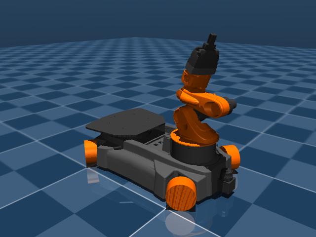

# MAPLE on a KUKA youBot: learning which primitive to run next

A KUKA youBot does tabletop pick-and-place with 18 mm cubes in MuJoCo. This repository
adapts [MAPLE](https://arxiv.org/abs/2110.03655) (Nasiriany, Liu, Zhu, ICRA 2022): instead of
a hand-written state machine, a policy chooses at every step which parameterized primitive
runs next — `grasp(x, y, z, yaw)`, `reach(x, y, z)` or `open()` — and with which parameters.
One RL step is one whole primitive, not one physics step.

<!-- TODO: GIF of the trained 1-cube policy, e.g. docs/media/sac/1 cube/sac_100k.mp4 -->

## Results so far

| Task | Scripted oracle | Learned policy |
|---|---:|---:|
| 1 cube, random start and goal | 100% after env fixes | **100%** (20/20 eval tasks, SB3 SAC, 100k primitive steps) |
| 4 cubes, fixed goals | 100/100 | **0%** in every run so far |

The four-cube result is the interesting part. Each primitive succeeds reliably (grasp success
1.0) and the oracle solves every task, yet the policy never learns the sequence. It
alternates `grasp` and `open` and almost never chooses `reach`. None of the following
changed that (each 100k primitive steps, Run 8 500k):

| Run | Change | Eval success |
|---|---|---:|
| 7, 8 | baseline SAC, then primitive fixes | 0% |
| 9 | `reach` snaps to the goal within 3 cm (random hit rate 0.25% → ~7%) | 0% |
| 10 | curriculum: episodes start with 1–4 cubes left to place | 0% |
| 11 | MAPLE-style hybrid policy and trainer, separate entropy for the primitive choice | 0% |

The skills work; long-horizon sequencing under sparse reward does not. Task variants that
need rearrangement (`occupied`: a goal is blocked by another cube; `swap`: two cubes must
trade places) are harder still and not yet attempted with RL.
Details, learning curves and failure analyses: [sac_training_report.md](sac_training_report.md).
Design of primitives, observation, action and reward: [maple_adaptation_plan.md](maple_adaptation_plan.md).

## What is implemented

- **Simulation** ([`mujoco/`](mujoco), [`youbot_pnp/robot`](youbot_pnp/robot)): youBot with
  5-DOF arm, parallel gripper and drivable omnidirectional base; gravity and Coriolis
  compensation; seeded task generator shared by all methods, so every method is evaluated
  on identical tasks.
- **Classical baseline** ([`youbot_pnp/fsm`](youbot_pnp/fsm), [`youbot_pnp/planners`](youbot_pnp/planners)):
  damped least-squares IK, top-down grasp sampling with collision filtering, OMPL RRTConnect,
  and a finite state machine that solves the task with a fixed cube order.
- **Primitives** ([`youbot_pnp/rl/primitives.py`](youbot_pnp/rl/primitives.py)): the FSM's
  handlers turned into parameterized primitives that report success. The policy gives
  rough targets; the primitive snaps them to the exact cube or goal when close enough, so the
  policy decides *what* and roughly *where* and the simulator supplies millimetre precision.
- **Affordance score** ([`youbot_pnp/rl/affordance.py`](youbot_pnp/rl/affordance.py)) as in MAPLE.
- **Gymnasium env** ([`youbot_pnp/rl/env.py`](youbot_pnp/rl/env.py)) with potential-based
  reward, and two learners: SB3 SAC with a flat action and a port of MAPLE's hybrid
  policy/trainer ([`youbot_pnp/rl/hybrid_sac.py`](youbot_pnp/rl/hybrid_sac.py)).

## Try it

```bash
conda env create -f environment.yml && conda activate hrl
python youbot_pnp/scripts/main.py --variant nominal --seed 0      # FSM baseline, opens a viewer
python youbot_pnp/scripts/check_oracle.py --cubes 4 --variant fixed_goals
python youbot_pnp/scripts/train_sac.py --cubes 1                  # 1-cube SAC, ~2–3 h on CPU
python youbot_pnp/scripts/train_hybrid.py --cubes 4 --variant fixed_goals --curriculum
python youbot_pnp/scripts/watch_policy.py runs/<run>/best_model.zip
```

## Setup

The MuJoCo tooling in this repo (viewer, mesh conversion, rendering) and the
`youbot_pnp` pick-and-place package run in a conda environment named `hrl`.
Python must be 3.10–3.13, since OMPL has no wheels for 3.14 yet.

```
conda env create -f environment.yml
conda activate hrl
```

Without conda, a plain virtualenv works too:

```
python3.13 -m venv .venv
source .venv/bin/activate
pip install -r requirements.txt
```

- [`requirements.txt`](requirements.txt): exact, tested package versions. It also installs
  `youbot_pnp` in editable mode, so it can be imported from anywhere and code changes apply
  without reinstalling.
- [`pyproject.toml`](pyproject.toml): the `youbot_pnp` package definition and its minimum
  dependencies.
- [`environment.yml`](environment.yml): the Python version, plus `requirements.txt`.

To update an existing `hrl` env after `requirements.txt` changed:

```
conda activate hrl
pip install -r requirements.txt
```

Quick check that everything works:

```
python youbot_pnp/scripts/check_ik.py
python youbot_pnp/scripts/view_scene.py
```

## MuJoCo Model

The MuJoCo model of the youBot (base + arm + gripper) is under
[`mujoco/`](mujoco):

- [`mujoco/youbot.xml`](mujoco/youbot.xml) — the robot alone: full-detail
  meshes for visual geoms, decimated `_convex` meshes for collision, and a
  freejoint base so it can drive and rest on the ground under physics.
- [`mujoco/environment.xml`](mujoco/environment.xml) — a reusable ground
  plane + lighting fragment.
- [`mujoco/scene.xml`](mujoco/scene.xml) — combines the two via MJCF
  `<include>`; this is the file to load for simulation.

```
conda activate hrl
python -m mujoco.viewer --mjcf=mujoco/scene.xml
```



## Simulation Setup & Technical Decisions

During the integration and tuning process in MuJoCo, several physical and technical challenges were resolved:

  1. Wheel-Ground Physics & Base Stabilization

**Initial issue:** Originally, the wheels penetrated the ground plane. Using a standard freejoint allowed the robot to rest on the surface, but introduced an undesirable constant physical drift in space.
**Problem:** Having an unpredictable spatial drift (varying in magnitude and direction) degraded calculation accuracy for kinematics and planning experiments.
**Solution:** The root cause was that the wheel collision geometries overlap with the chassis base by approximately 3 cm. Without explicit contact exclusions, the physics solver continuously attempts to resolve this internal penetration by spinning the wheels. Explicit contact exclusion pairs (`<exclude>`) between the chassis base and each wheel removed the drift. The base keeps its freejoint so it can drive, but during manipulation it is welded (equality `base_lock`) to the mocap body `base_anchor`, so it cannot move. To teleport the base, both are moved; to drive it, the weld is disabled and re-enabled on arrival.

  2. Environment & Table Setup for Cube Manipulation
     
**Reachability testing:** Initially, target cubes were spawned at arbitrary locations and varying heights to verify that the robot's workspace and arm kinematics could reach all target coordinates.
**Optimized stage:** Once reachability was confirmed across all points, a dedicated table with specific dimensions was designed and introduced to the scene. Placing all targets on this fixed-height surface simplifies training/learning workflows and allows using a static external camera with a reliable line of sight.

  3. On-Robot Camera Setup (Gripper Monitoring)
  
**Purpose:** To verify visual contacts between the end-effector (gripper) and the target cubes in real-time.
**Mounting:** An extended tripod mount was added directly onto the robot structure, placing an onboard camera at an optimal vantage point to observe the gripper fingers and grasping interactions without visual obstruction.


