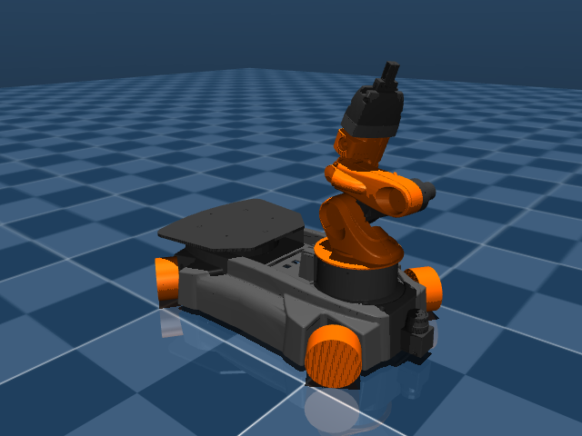

youbot_description
==================

Robot description in form of URDF files and meshes

## Setup

The MuJoCo tooling in this repo (viewer, mesh conversion, rendering) runs in a
conda environment named `hrl`. Recreate it from [`environment.yml`](environment.yml):

```
conda env create -f environment.yml
conda activate hrl
```

## MuJoCo model

Alongside the ROS URDF/xacro description, this repo has a MuJoCo model of the
youBot (base + arm + gripper), built from the same meshes, under
[`mujoco/`](mujoco):

- [`mujoco/youbot.xml`](mujoco/youbot.xml) — the robot alone: full-detail
  meshes for visual geoms, decimated `_convex` meshes for collision, and a
  freejoint base so it can drive and rest on the ground under physics.
- [`mujoco/environment.xml`](mujoco/environment.xml) — a reusable ground
  plane + lighting fragment.
- [`mujoco/scene.xml`](mujoco/scene.xml) — combines the two via MJCF
  `<include>`; this is the file to load for simulation.

```
conda activate hrl
python -m mujoco.viewer --mjcf=mujoco/scene.xml
```


